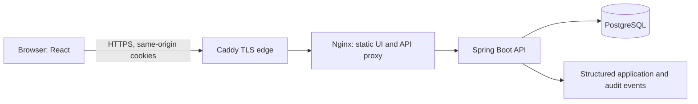

# Architecture

## Request path

Caddy belongs to the optional EC2 deployment. During native development, Vite proxies `/api` to the backend. The browser uses relative API URLs in both cases. This avoids maintaining different authentication implementations for local and deployed environments.

## Backend responsibilities

| Layer | Responsibility |
| --- | --- |
| Controllers | HTTP routing, authenticated identity, request validation, response codes |
| Services | Business rules, transaction boundaries, lock order, idempotent behavior |
| Repositories | Persistence queries and explicit database locks |
| Entities | Persisted users, wallets, transactions, sessions and audit records |
| DTOs | Narrow request/response shapes without password or internal entity exposure |
| Security/configuration | JWT cookies, CSRF, session validation, CORS, throttling and startup validation |
| Flyway migrations | Versioned schema, constraints and indexes |

This is a modular monolith. A wallet transaction should not cross several independently deployed services merely to look like a distributed system. PostgreSQL provides one atomic commit boundary for balance movement and its transaction record.

## Transfer lifecycle

1. The API authenticates the sender from the session. It does not accept a caller-supplied sender ID.
2. Validate recipient, positive integer amount, upper bounds, note length and a UUID idempotency key.
3. Resolve both wallet IDs and lock them in a deterministic order. Opposite-direction transfers follow the same order to reduce deadlock risk.
4. Check whether the sender already used that key. An identical retry returns the original transaction. A different payload with that key is a conflict.
5. Verify sufficient funds and that the recipient update cannot overflow.
6. Debit, credit and persist the transaction and audit information in one database transaction.
7. Commit before returning the receipt details. Failure rolls back the operation.

Idempotency guarantees apply to the defined operation and key scope, not to an arbitrary request that happens to look similar. Clients keep the same key while retrying an uncertain operation and create a new key for a genuinely new payment.

## Sandbox deposit lifecycle

The user creates a pending deposit intent; the client receives its reference but no credit. An external **sandbox simulator**, configured explicitly, signs a completion event. The server validates its raw-body HMAC, timestamp, amount, currency and intent identity. Database locking and unique callback identifiers prevent duplicate credit even if callbacks race or are replayed. This is a controlled demonstration of callback processing, not a bank webhook integration.

## One-time demo grant

The optional demo-funding path is separate from deposit callbacks. With the feature enabled, an authenticated account can manually claim one fixed **10,000-paise (₹100.00)** grant. Existing and new accounts use the same rule. The server locks the wallet, checks the persistent welcome-claim state and idempotency, and commits the balance increase, completed `DEMO_CREDIT` transaction and audit evidence together. Registration does not grant money automatically. Changing sessions or idempotency keys does not reset eligibility.

This is a per-account sandbox allowance, not provider settlement or verification of a person's identity. There is no user-selected amount and no further free top-up operation. The older signed-callback path remains available for explicit operator tests; pending deposit requests are not converted or completed by the demo claim. The bank-account interface is an **Under development** placeholder with disabled inputs; no bank details are collected or persisted.

## Query model

History is paginated with a maximum page size. Filtering and search are performed on the server under the authenticated user's visibility scope. CSV export uses the same filters and an explicit row limit. A receipt lookup uses the same ownership check; knowing another transaction UUID does not grant access.

Analytics use completed wallet activity, not pending deposit requests. All amounts remain integers from database to API. Display formatting occurs at the interface boundary.

A completed demo grant is credit activity for its completion period. V3 adds the welcome-claim state and `DEMO_CREDIT` type without deleting existing wallets or history. Older application versions must be reviewed before rollback because they may not understand the new transaction type.

## Why not microservices or a ledger service?

Independent services would add network failure, distributed idempotency and reconciliation problems without evidence that this portfolio workload needs them. A genuine double-entry ledger is a future design change requiring balanced postings, ledger-account semantics and reconciliation tests. The current design uses atomic wallet balance updates and transaction records and does not claim those are equivalent to a full accounting ledger.

## Growth path

The first deployment is a single EC2 host with an internal PostgreSQL container. It is inexpensive and understandable, but it has one host-level failure domain and requires operator-managed database backups. The next useful move is a private RDS PostgreSQL database and a separate runtime database role, followed by ECS/Fargate only when independent application scaling and managed rollouts justify the additional services and cost. Multi-instance deployment also requires reviewing process-local rate limiting and ensuring it is enforced consistently across instances.
