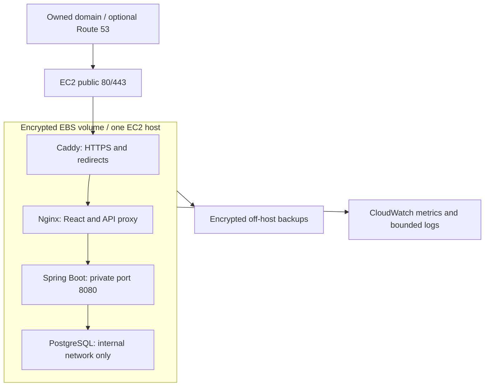

# AWS deployment preparation

For an existing uploaded-ZIP installation, use [the deployment update guide](DEPLOYMENT_UPDATE.md) rather than creating or cloning another installation. It preserves the current environment files, secrets and database volumes.

**No AWS resources have been provisioned by this package.** These instructions are for a future deployment that the owner explicitly authorizes. Creating a resource, publishing an image, allocating an IP address, or retaining a disk can incur charges. Build and test locally first.

## Recommended first deployment

Use one Linux EC2 instance for this low-traffic sandbox, running the supplied Compose stack:



Start with approximately **4 GiB host memory** for the JVM, PostgreSQL and build/runtime overhead, then measure. This is a planning starting point, not a benchmarked minimum. Build images in CI rather than on a tiny host. A 2 GiB instance may be viable after tuning, but must pass a realistic memory/load check first.

The trade-off is explicit: one machine is simple and inexpensive, but it is a single failure domain. A containerized PostgreSQL database needs operator-managed backup, patching and recovery. This is a portfolio sandbox architecture, not an availability claim for a financial service.

## Service choices

| Service | Initial choice | When it becomes useful |
| --- | --- | --- |
| EC2 | Yes, one small Linux host | Simple persistent sandbox and predictable operational model |
| ECR | Optional | Store reviewed, commit-tagged application images instead of building on the host |
| RDS PostgreSQL | Later | Managed backups, maintenance and optional Multi-AZ failover; additional cost |
| ECS/Fargate | Later | Managed tasks and rollouts when independent scaling justifies ALB/networking cost |
| S3 | Optional backups | Encrypted off-host dumps with retention/lifecycle rules |
| CloudFront + S3 frontend | Later | Static asset distribution at scale; cookie/API origin design must be revisited carefully |
| Route 53 | Optional | DNS hosting if an existing registrar/DNS provider is not used |
| CloudWatch | Recommended | Host memory/disk, container logs, health/5xx and cost-aware retention |
| Secrets Manager | Optional upgrade | Managed application secrets and restricted retrieval/rotation procedures |

The supplied Compose stack does not integrate automatically with all these services. The alternatives describe design decisions, not infrastructure already created.

## 1. Before creating anything

1. Choose a region and calculate the expected monthly bill using [the cost worksheet](COSTS.md).
2. Set AWS Budgets alerts and enable MFA on the account. Use IAM roles and an administrative identity with limited access; do not use root access keys.
3. Choose an owned DNS name. Prepare a security group allowing inbound **80/TCP and 443/TCP** only. UDP 443 is optional for HTTP/3. Do not expose 5432, 8080 or the Caddy admin API.
4. Prefer AWS Systems Manager Session Manager for host access. If SSH is necessary, allow it only from your current trusted IP, use a key, and remove the rule when unnecessary.
5. Select encrypted EBS storage. Decide on an off-host backup target and retention before adding meaningful data.

SSM needs an appropriate instance role plus outbound access to its endpoints. Private VPC endpoints and NAT gateways can have material additional costs; neither is silently created by this repository.

## 2. Prepare the host and repository

Use a supported Linux distribution with Docker Engine and Compose v2 installed from their maintained installation instructions. Keep operating-system security updates enabled. Restrict the Docker group: access to Docker is effectively administrative access to the host.

For a new installation, either upload the reviewed clean source ZIP or clone [this WalletPay repository](https://github.com/sai0543ganesh/WalletPay) into a dedicated deployment directory. The repository is public; cloning does not require a GitHub token. Keep all live credentials outside the repository. Do not clone your home directory or upload unrelated personal files. An existing ZIP deployment does not need to become a Git checkout.

The commands below assume the terminal is at the `WalletPay` repository root:

```sh
node infra/scripts/setup-env.mjs
```

This creates `.env` and independent random secret files under `.secrets/`, without overwriting existing values. It requires Node on this setup machine. Alternatively, securely prepare the same files from an approved secret store. On Linux, keep `.secrets/` owned by the deployment account with directory mode `0700`. The individual secret files need to be readable by their non-root container processes; local Compose secret mounts do not reliably remap host UID/GID permissions. For the supplied local-file approach, use read-only file mode `0444` inside this owner-only directory. Do not make the directory world-readable or store the files inside an image.

Edit only non-secret settings in `.env`:

```dotenv
DOMAIN=wallet.your-owned-domain.example
ACME_EMAIL=your-real-certificate-contact@example.com
ALLOWED_ORIGINS=https://wallet.your-owned-domain.example
COOKIE_SECURE=true
SPRING_PROFILES_ACTIVE=prod
SANDBOX_WEBHOOK_ENABLED=false
DEMO_FUNDING_ENABLED=false
```

Set `DEMO_FUNDING_ENABLED=true` only when you want authenticated users to manually claim the one-time simulated ₹100 allowance. Each account can claim once, including accounts created before the update. There are no automatic signup grants or repeat free top-ups. The bank-account area remains an Under development placeholder and stores no bank details. The separate signed sandbox callback feature stays disabled unless explicitly needed for operator tests.

Keep secrets out of tickets and screenshots. The JWT and callback secrets must each contain at least 32 UTF-8 bytes. The generated base64 text is used as the raw secret string; do not decode it before passing it to the application.

## 3. DNS and HTTPS

Point the chosen DNS name to the EC2 public address. An Elastic IP can provide stability, but public IPv4 addresses are billed. Verify both A and AAAA records; do not leave an AAAA record pointing somewhere that cannot serve this app.

Then, **only after deployment approval**:

```sh
docker compose --env-file .env -f infra/compose.yaml -f infra/compose.ec2.yaml config --quiet
docker compose --env-file .env -f infra/compose.yaml -f infra/compose.ec2.yaml up --build -d
docker compose --env-file .env -f infra/compose.yaml -f infra/compose.ec2.yaml ps
```

Caddy obtains certificates after public DNS and challenge reachability are correct. The edge image runs as a non-root user, listening on internal high ports mapped to public 80/443. It redirects HTTP to HTTPS. Its data volume preserves certificate state. Do not repeatedly delete that volume: certificate issuers enforce issuance limits.

The frontend host port remains loopback-only for local inspection; the public edge reaches it through the private Compose network. The strict backend production profile rejects insecure cookie/origin settings. Test login, a protected request and logout through HTTPS before relying on the deployment.

## 4. Database migrations and existing data

Flyway runs versioned migrations before Hibernate schema validation. `ddl-auto=update` is not the deployment migration strategy. For a fresh database, let the versioned migration create its schema. Store a backup before every schema change and review its SQL.

The new schema is not an automatic in-place upgrade of the original WalletPay database. For existing data, restore a copy into an isolated staging database, map old users/balances/transactions explicitly, verify totals, then test the migration. **Do not enable automatic Flyway baselining, drop tables, delete volumes, or change checksums to force a deployment through an unexplained failure.** If a migration fails, stop rollout and investigate.

Within this edition, V3 is an additive update for the optional one-time demo grant. It preserves existing account/history data and pending deposit intents. Once `DEMO_CREDIT` records exist, review older application versions for compatibility before any rollback. See [the update procedure](DEPLOYMENT_UPDATE.md).

For a larger deployment, run migrations once with a schema-owner role, then start the API with a restricted runtime role. The default single-host PostgreSQL container account owns the schema and is for the isolated sandbox.

## 5. Optional ECR publication and GitHub OIDC

The normal CI workflow verifies source and builds images; it has no AWS credentials and cannot provision anything. `publish-images.yml` is a separate manual action that requires confirmation and the `aws-publication` environment. It reruns the verification workflow before publishing.

When you authorize this step:

1. Create two private ECR repositories: `walletpay-api` and `walletpay-web`. Enable image scanning, an appropriate lifecycle policy, and immutable image tags.
2. Create the GitHub OIDC provider and a publication role with `infra/aws/ecr-publish-policy.json`, replacing its region/account placeholders. That policy can push only these repositories; it cannot create EC2, databases or deployments.
3. Restrict its trust policy to the exact repository **and publication environment**, with audience `sts.amazonaws.com`. `oidc-trust-policy.example.json` is intentionally a non-working template until its subject is configured.
4. Set GitHub environment variables `AWS_PUBLISH_ROLE_ARN` and `AWS_REGION`. Add an environment reviewer when the GitHub plan supports it. Do not store long-lived AWS access keys in repository secrets.
5. Inspect the repository's actual OIDC subject format. GitHub documents immutable owner/repository IDs in subjects for newly created repositories after July 15, 2026; do not copy an old owner/name-only trust pattern blindly.
6. Manually run the publication action with `PUBLISH`. Use the resulting commit-SHA image tags or immutable digests for a reviewed rollout. ECR storage and related service use can incur charges.

The EC2 Compose files build locally by default. To consume ECR images, create a reviewed override that sets each application service's `image` to the verified digest and removes/avoids its build step, authenticate the host through its pull-only instance role, then run `up --no-build`. Do not replace a running image with an unreviewed `latest` tag.

Sources: [GitHub OIDC for AWS](https://docs.github.com/en/actions/how-tos/secure-your-work/security-harden-deployments/oidc-in-aws), [AWS IAM OIDC role guidance](https://docs.aws.amazon.com/IAM/latest/UserGuide/id_roles_create_for-idp_oidc.html).

## 6. Observability, backups and rollback

Use [the operations guide](OPERATIONS.md). Set bounded log retention, monitor disk free space and database connections, and make off-host backup/restore testing part of the deployment. Never log JWTs, passwords, callback signatures or full personal-data payloads.

Application rollback means selecting a previous reviewed image. Database rollback is a separate decision: an old binary may not be compatible with a new schema. Prefer compatible additive migrations and a tested forward fix. Restore a database only through a deliberate recovery procedure with an understood recovery point.

## Deployment acceptance

Before calling the AWS deployment successful, verify public HTTPS/certificate renewal, forbidden direct ports, registration/login/logout and expired sessions, CSRF enforcement, receipts scoped to their owners, concurrent transfers, duplicate callbacks, container restarts with persistent data, usable backups, and alert delivery. The repository's local tests do not establish these AWS conditions automatically.
